# Network sync: design and architecture

How two or more Lagebuch devices work on one Einsatz together: who holds the
data, what crosses the wire, how a device joins and is trusted, and how every
device converges on the same Lage when the network misbehaves.

This page explains the mechanism. The code is the source of truth for every
number and name in it; each section points at the files that hold it. If the
two disagree, the code wins and this page has a bug.

- [1. The model in one paragraph](#1-the-model-in-one-paragraph)
- [2. Components and layering](#2-components-and-layering)
- [3. Network and deployment](#3-network-and-deployment)
- [4. Wire surface](#4-wire-surface)
- [5. The host's request pipeline](#5-the-hosts-request-pipeline)
- [6. Joining](#6-joining)
- [7. Trust and identity](#7-trust-and-identity)
- [8. Mutations: the command path](#8-mutations-the-command-path)
- [9. Convergence: epoch, revision and the reconcile poll](#9-convergence-epoch-revision-and-the-reconcile-poll)
- [10. Attachments](#10-attachments)
- [11. Stammdaten over sync](#11-stammdaten-over-sync)
- [12. Connection lifecycle and teardown](#12-connection-lifecycle-and-teardown)
- [13. The SignalR transport and #781](#13-the-signalr-transport-and-781)
- [14. Protocol versioning](#14-protocol-versioning)
- [15. Limits and timeouts](#15-limits-and-timeouts)
- [16. Threading model](#16-threading-model)
- [17. Where it is tested](#17-where-it-is-tested)
- [18. Known gaps](#18-known-gaps)

## 1. The model in one paragraph

One device **hosts** the Einsatz and is its only authority: it owns the
`.lagebuch` file, stamps every change with its own clock, and runs everything
time-driven (the ILS reminder, the Atemschutz alarms). Every other device is a
**thin client**. It never writes locally. Each edit becomes a *command* sent to
the host. The host applies it to its aggregate exactly as a local edit would be
applied, saves, and pushes the **whole incident snapshot** to every client.
A client's screen shows only what the last snapshot it accepted contained.
Snapshots carry a position (`epoch`, `revision`), and three independent
channels deliver them, so a lost or reordered message heals by itself.

What this design deliberately is **not**:

- **Not peer-to-peer and not mergeable.** There is no CRDT, no operational
  transform and no conflict resolution. Two edits to the same thing are applied
  in the order the host receives them. The host's domain guards reject what no
  longer applies, for example an entry another device has just removed.
- **Not offline-capable on a client.** A client that cannot reach the host
  disables input instead of queueing edits.
- **Not discovering.** The host's address and PIN are read off its screen and
  typed in. Nothing broadcasts or scans the network.
- **Not hostable from Android.** Android ships `NoopIncidentHostController`; only
  the desktop app embeds the server (it needs ASP.NET Core / Kestrel). Android
  joins as a client.

## 2. Components and layering

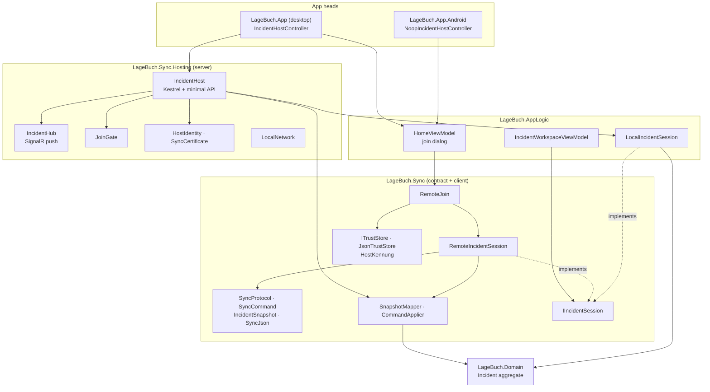

| Piece | Lives in | Role |
|---|---|---|
| `IIncidentSession` | [`src/LageBuch.Sync/IIncidentSession.cs`](../src/LageBuch.Sync/IIncidentSession.cs) | The one surface the workspace edits through. `LocalIncidentSession` (solo or host) and `RemoteIncidentSession` (joined client) both implement it, so the views do not know which one they have. |
| `LocalIncidentSession` | [`src/LageBuch.AppLogic/LocalIncidentSession.cs`](../src/LageBuch.AppLogic/LocalIncidentSession.cs) | Owns the incident file. Its `Changed` event is what the host broadcasts on. `SaveExternalChange()` is the host's path for a peer's command. |
| `IncidentHost` | [`src/LageBuch.Sync.Hosting/IncidentHost.cs`](../src/LageBuch.Sync.Hosting/IncidentHost.cs) | Kestrel + SignalR server for one open incident: gates, endpoints, the revision counter, the broadcast. |
| `IncidentHub` | [`src/LageBuch.Sync.Hosting/IncidentHub.cs`](../src/LageBuch.Sync.Hosting/IncidentHub.cs) | An empty hub. It carries only the server→client `snapshot` push and has no client-callable methods. |
| `JoinGate` | [`src/LageBuch.Sync.Hosting/JoinGate.cs`](../src/LageBuch.Sync.Hosting/JoinGate.cs) | Checks the PIN on every request and keeps the wrong-PIN budget. |
| `HostIdentity`, `SyncCertificate` | [`src/LageBuch.Sync.Hosting/`](../src/LageBuch.Sync.Hosting/) | Persistent host key, plus a fresh self-signed certificate per share. |
| `RemoteJoin` | [`src/LageBuch.Sync/RemoteJoin.cs`](../src/LageBuch.Sync/RemoteJoin.cs) | First half of a join: TLS pinning, version handshake, Stammdaten, first snapshot. |
| `RemoteIncidentSession` | [`src/LageBuch.Sync/RemoteIncidentSession.cs`](../src/LageBuch.Sync/RemoteIncidentSession.cs) | The live client: sends commands, accepts snapshots, polls, reconnects, tears down. |
| `SyncCommand` | [`src/LageBuch.Sync/SyncCommand.cs`](../src/LageBuch.Sync/SyncCommand.cs) | One record per domain mutation, behind a closed `[JsonDerivedType]` allowlist. |
| `CommandApplier` | [`src/LageBuch.Sync/CommandApplier.cs`](../src/LageBuch.Sync/CommandApplier.cs) | Maps a command onto the matching `Incident` method, with the host's clock. |
| `IncidentSnapshot`, `SnapshotMapper` | [`src/LageBuch.Sync/`](../src/LageBuch.Sync/) | The whole aggregate as JSON, and the mapping to and from `Incident.Rehydrate`. |
| `SyncProtocol` | [`src/LageBuch.Sync/SyncProtocol.cs`](../src/LageBuch.Sync/SyncProtocol.cs) | Port, paths, headers, timeouts, caps, protocol versions, the exception types. |

The layering follows [AGENTS.md › Architecture](../AGENTS.md#architecture):
`Sync` references only `Domain`. It cannot parse `MasterDataSet` (which lives
in `Persistence`), so the host's Stammdaten reach the client as an unparsed
JSON string that `AppLogic` parses (§11). `Sync.Hosting` is the one project
that pulls in ASP.NET Core, which is why only the desktop head references it.

## 3. Network and deployment

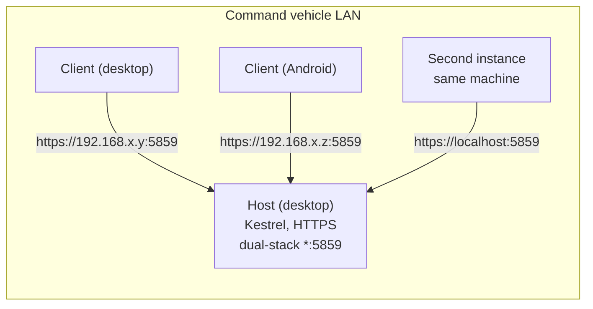

- **Binding.** `IncidentHostController.StartAsync` passes `IPAddress.Any`. For
  either wildcard, `IncidentHost.StartAsync` calls `ListenAnyIP`, which gives a
  dual-stack IPv4+IPv6 socket that falls back to IPv4 by itself. A specific
  address, such as loopback in every test, binds just that address. The port is
  fixed at `SyncProtocol.Port` = **5859**. Port 0 (tests) lets the OS choose,
  and `BoundPort` reports the result.
- **Which address to show.** `LocalNetwork.DisplayAddress()` is cosmetic: it
  picks one IPv4 address to put on screen, falling back to loopback. The host
  listens on every interface whatever this shows.
- **Other networks.** The command vehicle's own LAN is the tested setup. In
  theory any network that routes to the host works, e.g. a VPN such as
  Tailscale, because the host binds every interface and trust does not depend
  on the address. That setup is untested.
- **What the Lagebuchführer reads out.** The address, a fresh four-digit
  **PIN** (`RandomNumberGenerator.GetInt32(0, 10_000)`, new per share and per
  renewal) and the host's **Kennung**, e.g. `7K2Q-M9XD-4HPA`, for comparing on
  a first join or after a key change (§7).
- **Everything is HTTPS.** There is no plain-HTTP listener. The PIN travels
  inside TLS.

## 4. Wire surface

All paths are constants in `SyncProtocol`. Every request, the hub included,
carries two headers:

| Header | Value | Checked by |
|---|---|---|
| `X-Lagebuch-Pin` | the share PIN | `JoinGate`, on every request |
| `X-Lagebuch-Protocol` | the client's `SyncProtocol.ProtocolVersion` | the protocol gate, on every request except `/version` |

| Method + path | Answer | Used for |
|---|---|---|
| `GET /version` | `VersionInfo { version, protocol, minProtocol }` | the handshake (§6, §14) |
| `GET /masterdata` | the host's Stammdaten as `MasterDataJson` | once per join (§11) |
| `GET /snapshot` | `IncidentSnapshot` with `epoch` + `revision` | the join, and every reconcile that finds a gap |
| `GET /revision` | `RevisionInfo { revision, epoch, hostTime }` | the reconcile poll every 10 s (§9) |
| `POST /command` | the `IncidentSnapshot` after the apply | every mutation (§8) |
| `GET /files/{id}` | attachment bytes | on demand (§10) |
| `PUT /files/{id}` | `204` | upload after `addFile` (§10) |
| `/hub` (SignalR) | server→client method `snapshot(IncidentSnapshot)` | the push after every change |

Status codes a client has to understand:

| Code | From | Meaning |
|---|---|---|
| `401` | PIN gate | wrong, missing or duplicated PIN, or joins closed. The same answer every time, so a guesser learns nothing. |
| `426` | protocol gate | the client is below the host's floor. The body is a German sentence that names this device as the one to update. |
| `400` | `POST /command` | a domain guard refused the command. The body is the host's German reason, or `UnknownIdReason` for an unknown id (#602). |
| `403` | `POST /command` | `close` from a peer. Only the host closes an Einsatz (#465). |
| `413` | `PUT /files/{id}` | over `IncidentFile.MaxSizeBytes`. |
| `500` | `POST /command` | a `removeFile` whose metadata removal landed but whose byte wipe failed. |
| `429` | *older hosts only* | the pre-#288 per-address backoff. Still mapped by the client, because the fleet is mixed. |

**Serialization.** Everything on the wire goes through `SyncJson.Options`
([`SyncJson.cs`](../src/LageBuch.Sync/SyncJson.cs)): web defaults (camelCase,
case-insensitive read) and enums as strings. The hub's JSON protocol and the
minimal-API binder are configured with the same `JsonStringEnumConverter` on
both ends. Commands are polymorphic on `$type` over the closed allowlist on
`SyncCommand`. Nothing on the wire ever names a CLR type.

## 5. The host's request pipeline

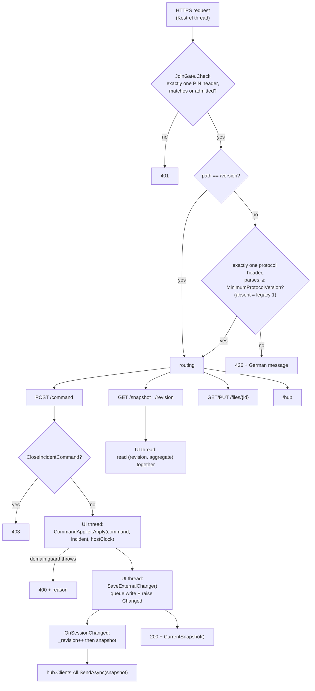

The ordering here is deliberate:

- **Auth before content.** The PIN gate runs first, so an uninvited peer never
  learns which protocol revisions the host speaks.
- **`/version` skips the protocol gate.** It *is* the negotiation endpoint. A
  peer that cannot read it can never learn why it was refused or which device
  to update. It still sits behind the PIN.
- **The host's protocol check is one-sided.** It refuses below its floor and
  lets a higher number through: that peer has already read `/version` and
  chosen to speak down. The client is the end that sees both ranges, so the
  client decides (§14).
- **The UI thread owns the aggregate.** `HandleCommand`, `/snapshot` and
  `/revision` all dispatch through `IUiDispatcher.InvokeAsync`, and
  `LocalIncidentSession.Changed` is always raised there. That keeps Avalonia's
  bound views on the host safe, and it makes `(revision, aggregate)` one
  consistent pair: between two mutations the UI thread sees both or neither.
- **Increment, then serialize.** `OnSessionChanged` bumps `_revision` *before*
  building the snapshot. A pair of revision N with N+1's content is harmless,
  because the client re-accepts that content as N+1 later. The reverse pair
  would leave the client stuck on old content under a new number.
- **The host's own edits take the same path.** A local edit raises `Changed`,
  which bumps the revision and broadcasts. A peer's command reaches the
  aggregate through `SaveExternalChange()` and ends the same way, so host and
  peer edits cannot diverge.

## 6. Joining

A join comes in two halves (#459). The host's Stammdaten and incident are read
before anyone on this device is named, so the dialog can suggest the host's own
personnel and call signs and say which Einsatz is being joined.

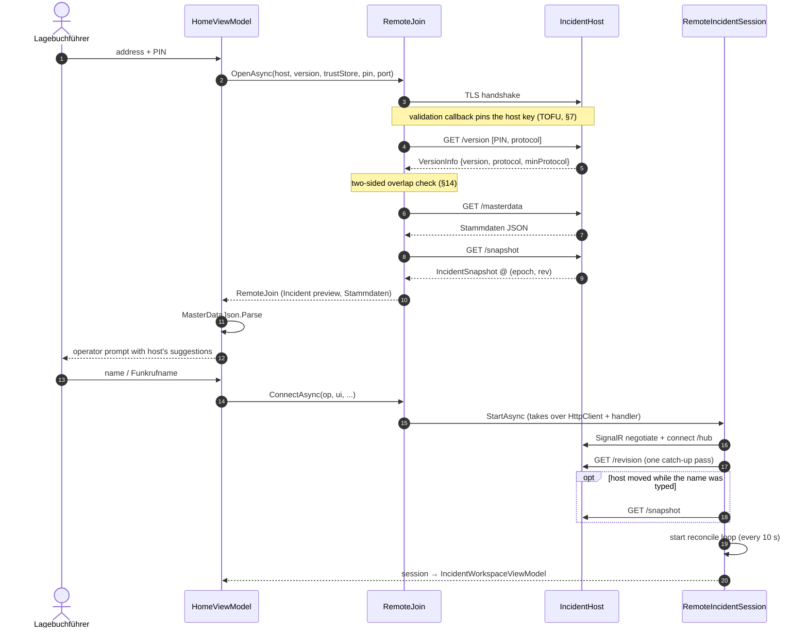

The connection is handed over, not copied. `RemoteJoin` owns the `HttpClient`
and its pinned `HttpClientHandler` until `ConnectAsync` passes both to the
session, and `DisposeAsync` releases them if the dialog is abandoned. A
`_spent` flag makes sure exactly one of the two happens.

Failures and what the Lagebuchführer sees:

| Exception | Raised when | Note |
|---|---|---|
| `PinRejectedException` | `/version` answers 401, or 429 from an old host | the 429 message names the wait time |
| `VersionMismatchException.ThisDeviceIsTooOld` | host's `minProtocol` > our `ProtocolVersion`, or a 426 | names both app versions |
| `VersionMismatchException.HostIsTooOld` | host's `protocol` < our `MinimumProtocolVersion` | names both app versions |
| `CertificateChangedException` | the presented key differs from the pinned one | unwrapped from the `HttpRequestException` the TLS stack wraps it in |
| `CertificateChangedException.Forged` | same Kennung, different key | refused outright, nothing offered to trust |
| `HttpRequestException` | host unreachable or not sharing | |
| `HostMasterDataUnreadableException` | the Stammdaten body does not parse | raised in `HomeViewModel`; the join is released |

## 7. Trust and identity

The host has no certificate a client could check against a CA, so trust works
like SSH: **Trust-on-First-Use, pinned to the host's key**, plus a short
**Kennung** a person can compare on both screens.

**Host side.**

- `HostIdentity.LoadOrCreate(path)` keeps one P-256 key per install, stored as
  PKCS#8 PEM with owner-only permissions under `AppPaths.HostKeyPath`. A
  missing or unreadable key is replaced, which gives a new Kennung, and clients
  will then ask to compare. If two instances share for the first time at once,
  both end up with the key that reached disk first.
- `SyncCertificate.Generate(key)` mints a **new self-signed certificate per
  share**: subject `CN=LageBuch-Sync-Host`, SAN `localhost`/`127.0.0.1`/`::1`,
  the Server-Auth EKU (Schannel requires it), valid for 24 h, and round-tripped
  through PFX so Schannel can use the key. The certificate changes on every
  share; the key does not.
- `HostKennung.Of(cert)` is shown on the host. It is the first 60 bits of
  `SHA-256(SPKI)` in Crockford base32 (no I/L/O/U), written `XXXX-XXXX-XXXX`.

**Client side.** `RemoteJoin.OpenAsync` installs one
`ServerCertificateCustomValidationCallback` on the `HttpClientHandler` that
serves the HTTP calls and the hub's HTTP requests (but see §13). The store is
`ITrustStore` (`JsonTrustStore` in both heads), keyed by the dialled address.

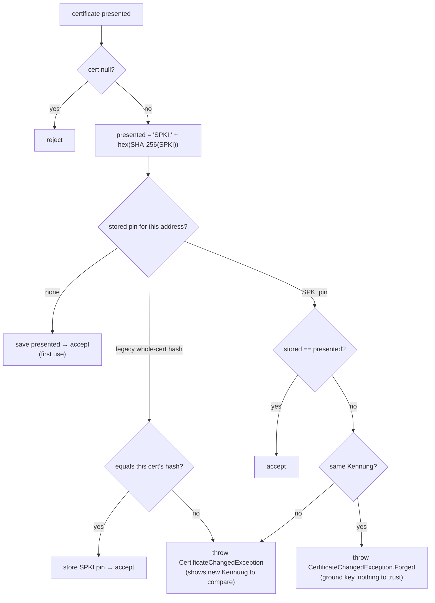

The way out of a changed-host banner is `ITrustStore.RemoveThumbprint`:
after the Lagebuchführer has compared the Kennung, the next connect re-pins.

> **Invariant.** No code path accepts a certificate without this check: no
> accept-any fallback, not in tests, not in a debug build. `RemoteJoin.OpenAsync`
> requires an `ITrustStore` and throws without one. See
> [AGENTS.md › Security](../AGENTS.md#security).

**The PIN budget (`JoinGate`).**

- Every request must carry exactly one `X-Lagebuch-Pin`. Missing, duplicated
  or wrong all count as wrong.
- One budget per PIN across **every** address (#288): after
  `MaxFailuresPerPin` = **10** wrong PINs, joins close and the host's UI shows
  it. Only a person renewing the PIN (`RenewPin` → `ReplacePin`) reopens them.
  That human step is what caps an attacker at 10 in 10,000 per renewal.
- A device that got in is remembered as `(ip, pin)` and keeps working after a
  renewal, so devices already joined are not locked out.
- A request with no remote address is refused without spending the budget.
- The comparison is ordinal, not fixed-time. That is the documented exception,
  since a four-digit PIN inside TLS is not a timing target; see the comment in
  `JoinGate.Check`.

## 8. Mutations: the command path

Every `IIncidentSession` mutation on `RemoteIncidentSession` builds a
`SyncCommand` and sends it. About forty `void` methods do this fire-and-forget
via `Send`. `AddFileAsync` and `RemoveFileAsync` await `SendAsync` and throw
to their caller.

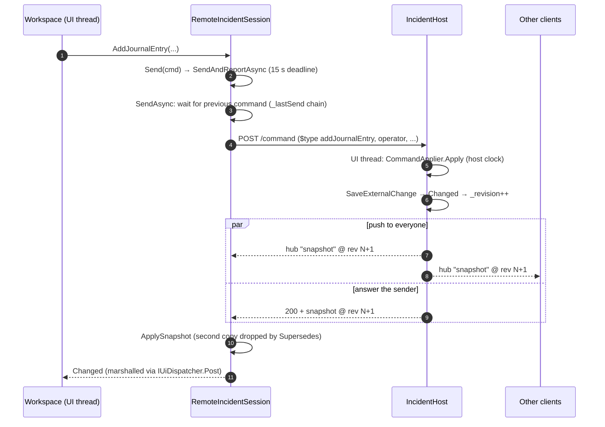

- **Attribution.** Commands whose domain method credits someone carry an
  `OperatorDto` (name + Funkrufname) from the sending device, so an ETB line is
  credited to the person at that device. Changing the operator is a client-side
  fact plus one logged `changeOperator` command (#469). **Time is always the
  host's**: `CommandApplier` passes the host's `IClock`.
- **Client-minted ids.** Where a client needs to refer to what it just created,
  it mints the id itself: `addJournalEntry.entryId`, then `addTask.sourceEntryId`
  to link to it, and `addFile.fileId` for the upload that follows.
- **Order (#767).** `SendAsync` chains every command behind the previous one
  through `_lastSend`. The new tail is published before anything is awaited.
  Without the chain, concurrent POSTs on different pooled connections could
  overtake each other, so that a correction reached the host before its entry
  and was refused as an unknown id.
- **Outcomes reported on the fire-and-forget path (`SendAndReportAsync`).**
  - `400`: `CommandRejectedException` → `CommandRejected(reason)` →
    banner "Änderung nicht übernommen: …".
  - Another HTTP status: `DescribeRefusal` gives a German sentence for 401, 429,
    426 and 413, and "Fehler NNN" for anything else.
  - No answer within `CommandTimeout` (15 s), or the link broke:
    `CommandLostReason` (#764). Whether the host applied the command is
    unknown, so the text asks the Lagebuchführer to check, not to retype.
  - A success body that cannot be read is ignored: the revision moved, and the
    reconcile poll fetches the result.
- **The host's reason is untrusted text.** `ReadRejectionAsync` reads at most
  4 KiB, accepts either a JSON string literal or plain text, drops control and
  Unicode format characters (bidi overrides, zero-width joiners) and cuts the
  result to 300 characters. Only then does it reach the banner.

## 9. Convergence: epoch, revision and the reconcile poll

The same state reaches a client over **three channels that nothing orders
against each other**:

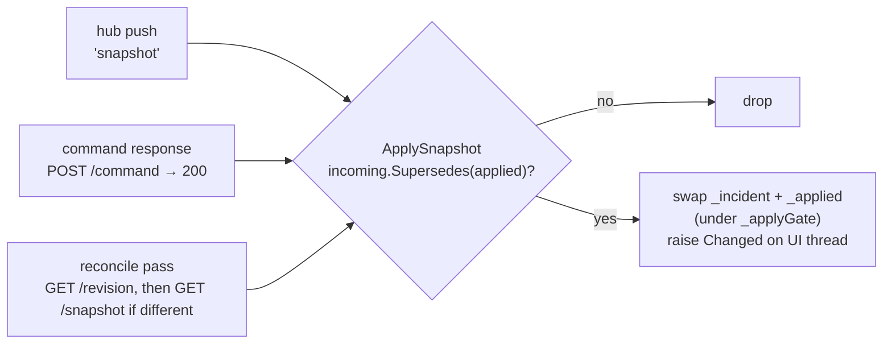

**Position.** `SyncPosition(Epoch, Revision)`
([`SyncPosition.cs`](../src/LageBuch.Sync/SyncPosition.cs)), #295:

- `revision` is the host's change counter. It is in memory and per host
  instance, not persisted.
- `epoch` is a random `Guid` drawn by every `IncidentHost.StartAsync`, so a
  revision from one share session is never compared with one from another.
- `Supersedes(held)` is `epoch ≠ held.epoch || revision > held.revision`. Within
  an epoch only newer content wins, so duplicates and overtaken copies are
  dropped. Across epochs a different epoch always wins, because the counters
  are unrelated. (Consequence: a late copy from an *older* epoch would also
  win. That is accepted, because the next poll finds the mismatch.)

**The reconcile poll (anti-entropy).** `ReconcileLoopAsync` runs a
`PeriodicTimer` every `DefaultReconcileInterval` (**10 s**). Each pass:

1. `GET /revision` under a `ReconcileTimeout` (**5 s**) deadline, so a link that
   went silent fails the pass instead of waiting out `HttpClient`'s 100 s.
2. If the host's `(epoch, revision)` differs **in any way** from the applied
   one, `GET /snapshot` and hand it to `ApplySnapshot`. A broadcast that
   overtakes the fetch still wins there.
3. Raise `Reconciled` on success or `ReconcileFailed` on any failure. The loop
   never ends on a failure; only disposal ends it.

The workspace footer's **Stand** comes from these events: `Reconciled` stamps
it as confirmed, `ReconcileFailed` turns it to "nicht bestätigt", and
`Disconnected` does so at once. A received push alone does not count as
evidence that the screen is current; only a confirmed position does.

The loop runs while SignalR is reconnecting too: a successful poll during an
outage is real information. On Android the process freezes while in the
background. `PeriodicTimer` does not replay missed ticks, so resuming costs
exactly one catch-up pass, and nothing derives state from wall-clock deltas.

**Host clock.** `/revision` also carries `hostTime` (protocol 18). For a round
trip of at most `MaxClockSampleRoundTrip` (**1 s**), with a time that is not
within a year of `DateTimeOffset`'s limits, the client stores
`offset = hostTime − (now − rtt/2)`. `HostClock` is the device clock plus that
offset, and the workspace runs its countdowns (Atemschutz, Aufgaben timers) on
it, since every instant in the incident was stamped by the host. If the offset
gets large, the workspace shows a clock-skew warning.

## 10. Attachments

A snapshot carries file **metadata** only; the bytes travel separately, so a
broadcast stays small however many photos are attached (#167).

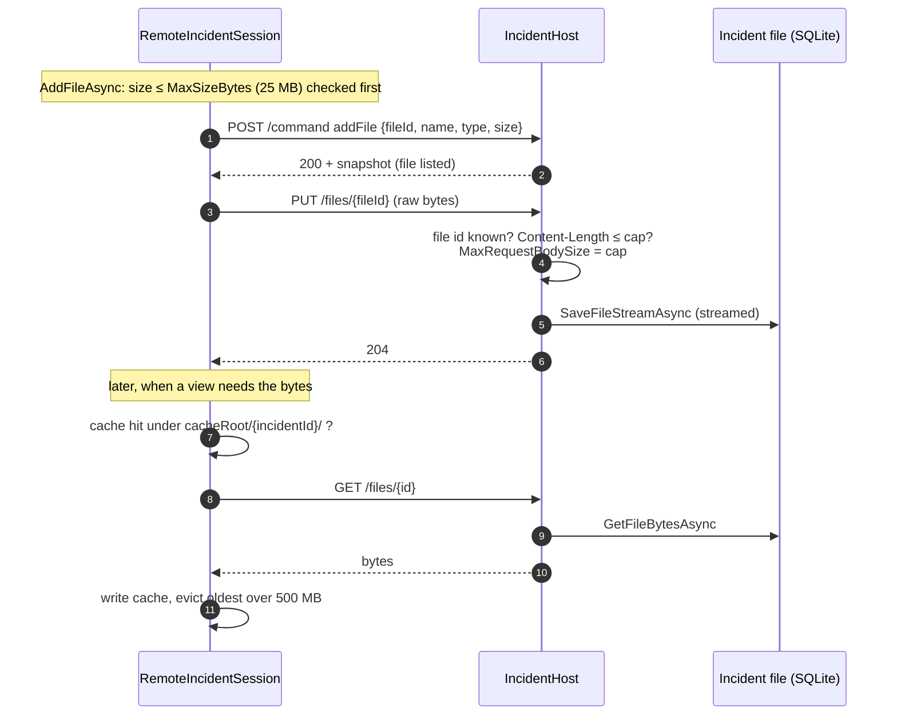

- The size cap is enforced on both ends: the client checks before sending,
  and the host checks `Content-Length` and also sets `MaxRequestBodySize`, so a
  body that lies about its length is cut off at the cap. Every response the
  client buffers is bounded by `MaxResponseBytes` (cap + 8 MB) through
  `HttpClient.MaxResponseContentBufferSize`.
- The cache lives in one folder per incident. It is deleted when the session
  is disposed, and `ClearAttachmentCache` clears leftovers from crashed runs at
  startup (#382). Eviction is oldest-by-write across the whole cache root.
- A failed fetch returns `null` (the host is unreachable) and never throws into
  the view.
- `removeFile` removes the metadata through the normal apply and broadcast, and
  the host then deletes the bytes. If that wipe fails, the client gets a
  **500** even though the removal landed; see §18.

## 11. Stammdaten over sync

The **host is the Stammdaten master** (#183). It serializes its
`MasterDataSet` once, in the `IncidentHost` constructor, and serves that string
at `/masterdata`. A joined client runs the session on the host's set instead of
its own, so both devices offer the same Wachen, Funkrufnamen and Personen and,
operationally the part that matters, the same Einsatzzeiten and
Rückzugsdruck. A host that never imported anything serves an empty set, and its
clients run empty too.

The set is fetched once per join and not again on reconnect, because the value
handed out cannot change while the host is sharing. Additions to the payload
are protocol bumps like any other (§14). That the incident holds copied
*values*, not references into the catalogue, is a separate rule: see
[AGENTS.md › Stammdaten in an incident](../AGENTS.md#stammdaten-in-an-incident).

## 12. Connection lifecycle and teardown

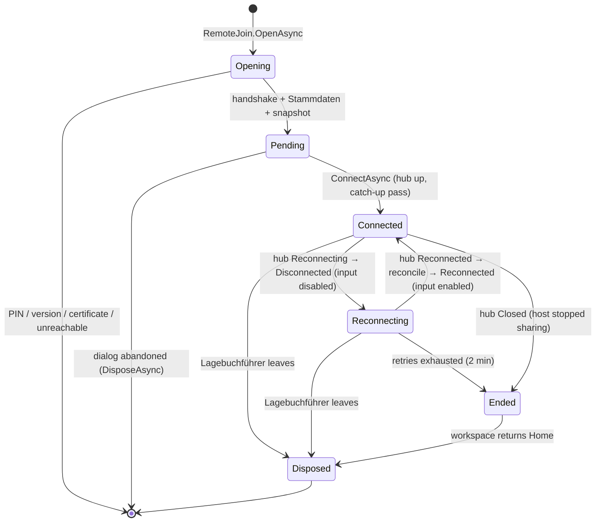

- **Reconnect policy.** `ReconnectForAWhile` retries every **3 s** for
  **2 min**. SignalR's default gives up after about 30 s, which is too short for
  a mobile link in the field. On `Reconnected` the session runs one reconcile
  pass, wrapped so that a failing pass still raises `Reconnected`. Without that
  wrapper the workspace would stay disabled for good.
- **The handler is borrowed.** SignalR disposes whatever
  `HttpMessageHandlerFactory` returns each time a connection ends, but the
  session's `HttpClient` runs on the same handler. `BorrowedHandler` is a
  `DelegatingHandler` whose `Dispose` does nothing, so the first dropped link no
  longer disposes the handler under every later request. It also links each
  request to `_transportAbort` (#778).
- **Teardown order (`DisposeAsync`, idempotent).**
  1. Cancel the reconcile loop and **await** it, so no GET lands on a disposed
     client.
  2. Dispose the hub, which politely POSTs a close. Wait at most `CloseGrace`
     (**2 s**). The host does not need the close, because it sees the
     connection drop.
  3. If the grace runs out, cancel `_transportAbort`, which ends every request
     the transport still holds open. On a silent link this used to mean a
     120 s wait (#778).
  4. Dispose `HttpClient`, the handler, the timer and the token sources.
  5. Delete this incident's attachment cache.
- **The host stopping.** `IncidentHost.StopAsync` unsubscribes from `Changed`,
  stops Kestrel and disposes the certificate. Clients see the hub close, give
  up after the reconnect window and return Home.

## 13. The SignalR transport and #781

The hub connection is built in `RemoteIncidentSession.StartAsync` with
`HubConnectionBuilder().WithUrl(base + "/hub", options)`. The PIN and protocol
headers go on `options.Headers` (a separate header bag: sharing the handler
does not share `HttpClient.DefaultRequestHeaders`), and
`options.HttpMessageHandlerFactory` returns the borrowed, pinned handler.

SignalR first POSTs `/hub/negotiate`, then tries transports in order:
**WebSockets → Server-Sent Events → Long Polling**.

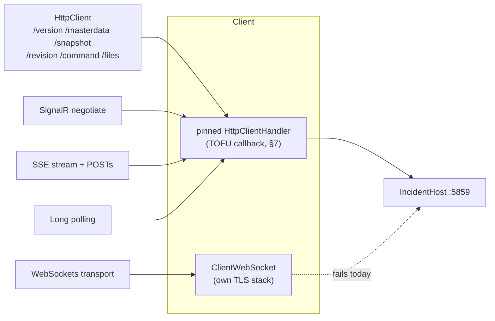

**What happens today (#781).** Every connect tries WebSockets, fails with a
`WebSocketException`, negotiates a second time and runs on SSE. Nobody notices,
because the fallback works. The costs:

- Every connect and reconnect spends a failed handshake plus a second
  negotiate round trip.
- On SSE only host→client is a stream. Every client→host message is its own
  HTTP POST. (Lagebuch sends no hub messages client→host apart from SignalR's
  own pings and the close, because commands go over `POST /command`.)
- SSE has none of the WebSocket transport's behaviour: `CloseTimeout` applies
  to WebSockets only, which is why #778 had to add `CloseGrace`.

**Likely cause (unverified, per the issue).**
`HttpMessageHandlerFactory` covers negotiate, SSE and long polling. The
WebSocket transport builds its own `ClientWebSocket`, which presumably checks
the self-signed certificate against the system store and fails. The fix
directions named in the issue:

- `HttpConnectionOptions.WebSocketFactory` connecting the socket through the
  pinned handler (`ClientWebSocket.ConnectAsync(uri, new HttpMessageInvoker(handler), ct)`); or
- `HttpConnectionOptions.WebSocketConfiguration` setting the same pinning
  callback on `ClientWebSocketOptions.RemoteCertificateValidationCallback`.

Whichever is chosen must keep:

- the socket pinned through `ITrustStore` exactly like the HTTP requests (never
  an accept-any callback, §7);
- `X-Lagebuch-Pin` and `X-Lagebuch-Protocol` on the upgrade request, with the
  host's middleware accepting them there (both gates run before routing, so the
  upgrade passes through them like any other request);
- Android, whose `ClientWebSocket` runs on a different platform stack;
- SSE as the fallback for networks that break WebSockets;
- `CloseGrace` as the bound for whichever transport is in use.

The first diagnostic step is to log the `WebSocketException`'s inner
exception. The test target is a client connecting over WebSockets against the
real host that still refuses a host whose certificate changed, with
`LinkFailureTests` passing over WebSockets.

## 14. Protocol versioning

Two devices may sync when their **wire contracts** overlap, never because
their app versions match. A volunteer fleet runs mixed releases, and Android
updates wait on Play review. The rule is in
[AGENTS.md › Sync protocol version](../AGENTS.md#sync-protocol-version), and
the full changelog of the contract is the remarks on
`SyncProtocol.ProtocolVersion` in
[`SyncProtocol.cs`](../src/LageBuch.Sync/SyncProtocol.cs). In short:

| Constant | Meaning |
|---|---|
| `ProtocolVersion` | the contract this build speaks (currently 25) |
| `MinimumProtocolVersion` | the oldest contract it still serves (currently 24) |
| `LegacyProtocolVersion` | what an absent or `0` number means: the v0.6.1 contract, = 1 |

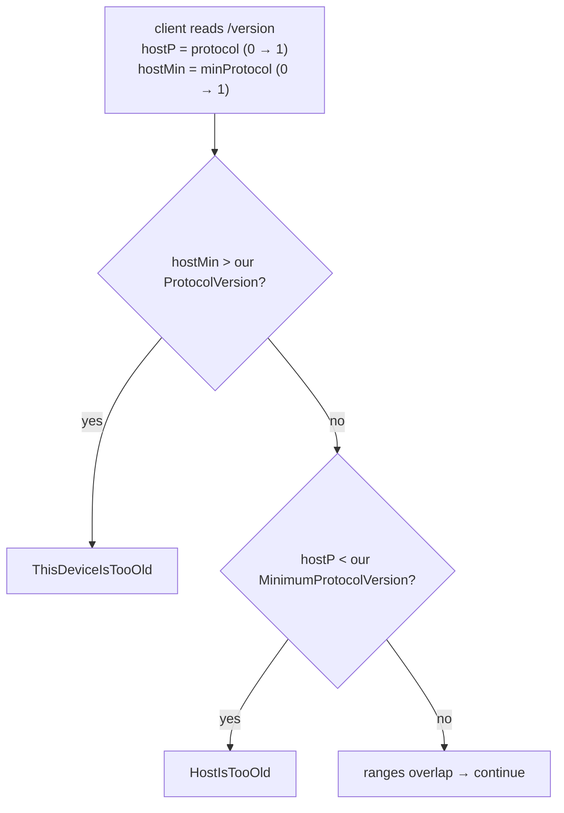

The host only checks `X-Lagebuch-Protocol ≥ its MinimumProtocolVersion`, with
an absent header counting as legacy (§5).

**Which number to raise for a wire change:**

- *A peer at the floor can ignore it* (a new optional command field with a
  defaulted parameter, a new snapshot or Stammdaten property): raise
  `ProtocolVersion` alone.
- *A peer at the floor cannot handle it* (a new command a client may send, a
  renamed or removed field, a changed enum contract, or a field whose absence
  a newer host would read as "cleared", like `setAddress` at 8 and
  `updateDwellingDetails.keyNumber` at 24): raise `MinimumProtocolVersion` too.

Two open PRs that both bump the protocol collide the way two migrations do:
renumber the second one above `main` before it merges.

## 15. Limits and timeouts

| What | Value | Where |
|---|---|---|
| Port | 5859 | `SyncProtocol.Port` |
| Attachment cap | 25 MB | `IncidentFile.MaxSizeBytes` |
| Any buffered response | cap + 8 MB | `SyncProtocol.MaxResponseBytes` |
| Rejection reason read / shown | 4 KiB / 300 chars | `RemoteIncidentSession.ReadRejectionAsync` |
| Reconcile interval | 10 s | `SyncProtocol.DefaultReconcileInterval` |
| Reconcile pass deadline | 5 s | `SyncProtocol.ReconcileTimeout` |
| Command deadline | 15 s | `SyncProtocol.CommandTimeout` |
| Clock sample max round trip | 1 s | `SyncProtocol.MaxClockSampleRoundTrip` |
| Reconnect | every 3 s for 2 min | `RemoteIncidentSession.ReconnectForAWhile` |
| Close grace on leave | 2 s | `RemoteIncidentSession.CloseGrace` |
| Wrong PINs per PIN | 10 | `JoinGate.MaxFailuresPerPin` |
| PIN space | 0000–9999 | `IncidentHostController.NewPin` |
| Attachment cache | 500 MB | `RemoteIncidentSession.DefaultCacheMaxBytes` |
| Certificate validity | 24 h, new per share | `SyncCertificate.Generate` |

## 16. Threading model

**Host.** Kestrel runs each request on a pool thread. Anything that reads or
mutates the aggregate, or reads `_revision`, hops to the UI thread through
`IUiDispatcher.InvokeAsync`. The file endpoints are the exception: they move
bytes through the incident file's own store without the hop, and only look up
the file's metadata in the aggregate's file list. `JoinGate` has its own
lock and raises `Closed` outside it.

**Client.** Three sources call into the session off the UI thread: SignalR's
receive loop (`snapshot`, `Reconnecting`, `Reconnected`, `Closed`), HTTP
continuations (command responses) and the reconcile loop (started with
`Task.Run` so it does not capture Avalonia's context). All of them:

- take `_applyGate` around the read-modify-write of `(_incident, _applied)`, and
  raise `Changed` *outside* it, because subscribers re-enter;
- notify the workspace through `IUiDispatcher.Post`, **never** `InvokeAsync`
  from the loop. The workspace awaits `DisposeAsync` on the UI thread and
  disposal awaits the loop, so a loop waiting on the UI thread would deadlock.

Under `ImmediateUiDispatcher` (tests), `Post` runs inline, which is why
`_applyGate` is genuinely contended and not merely defensive.

## 17. Where it is tested

| Suite | File | Covers |
|---|---|---|
| `LageBuch.Sync.Tests` | `CommandApplierTests` | each command → domain call |
| | `CommandSerializationTests` | the `$type` allowlist, round trips |
| | `SnapshotRoundTripTests` | `Incident` ⇄ `IncidentSnapshot` |
| | `SyncPositionTests` | the ordering rule, exhaustively |
| | `VersionHandshakeTests` | `/version` payload across older and newer builds |
| `LageBuch.Sync.Hosting.Tests` | `IncidentHostTests`, `RemoteClientTests` | the real host and client end to end |
| | `RemoteJoinTests`, `HomeViewModelJoinTests` | the two-phase join and its failures |
| | `JoinGateTests`, `HostIdentityTests`, `HostKennungTests`, `SyncCertificateTests`, `JsonTrustStoreTests` | trust and the PIN budget |
| | `WireContractTests` | the contract, asserted against the real host *and* `ScriptedSnapshotHost` |
| | `SnapshotRevisionTests`, `SnapshotReconcileTests` | the revision guard and the poll (#295) |
| | `CommandOrderTests`, `CommandRejectionTests` | order (#767) and refusal reporting |
| | `LinkFailureTests` + `FaultyRelay` | a real TCP relay that resets or silences the link |
| | `MasterDataSyncTests` | Stammdaten from the host (#183) |
| | `WorkspaceCollaborationTests` | two real workspaces over loopback |

`FaultyRelay`, `ScriptedSnapshotHost` and `StubHost` exist so that no test
hook has to live in production code. Time is driven by a `FakeTimeProvider`
handed to `ConnectAsync`, and `ReconcileAsync` is `internal` so a test can run
exactly one pass.

## 18. Known gaps

- **WebSockets never connect; every client runs on SSE** (#781, §13).
- **A failed byte wipe after `removeFile`** answers 500 although the removal
  landed. The client's banner reads as a refusal, the bytes may remain in the
  incident file, and the host's own UI is not told (see `HandleCommand`).
- **A late snapshot from an older epoch** is accepted until the next poll
  corrects it (§9). This is accepted by design.
- **`_revision` is in memory only.** A restarted share is a new epoch, and
  clients re-fetch. This is by design.
- **Android cannot host.** It has no embedded Kestrel there.
- **No discovery.** Address and PIN are typed in.
